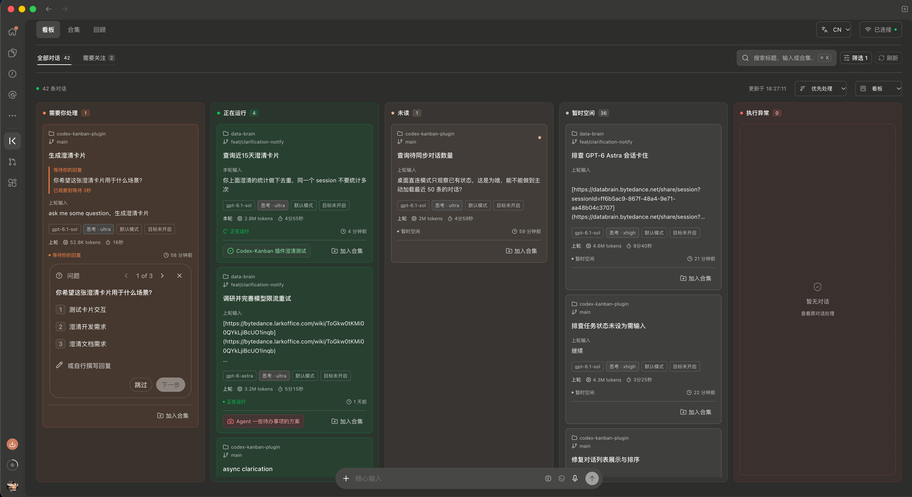
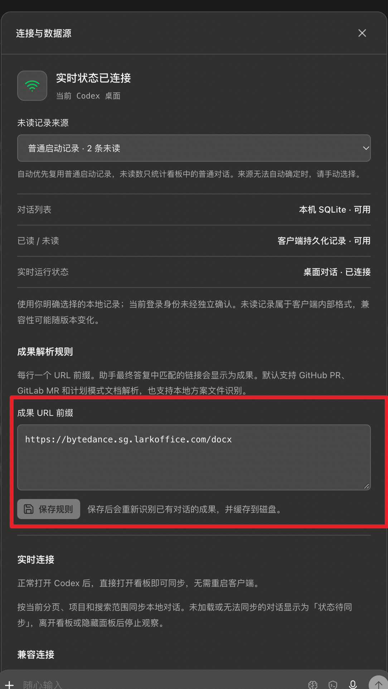
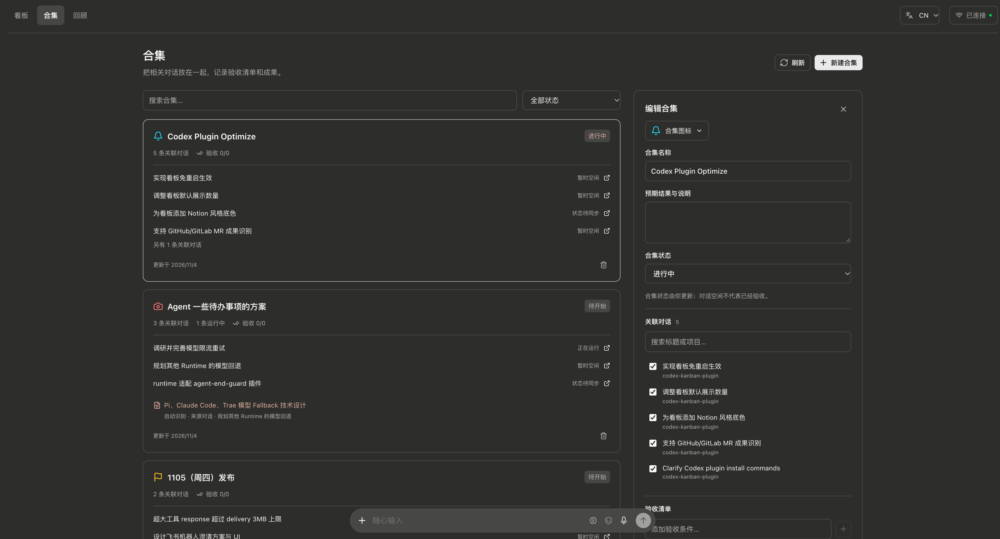
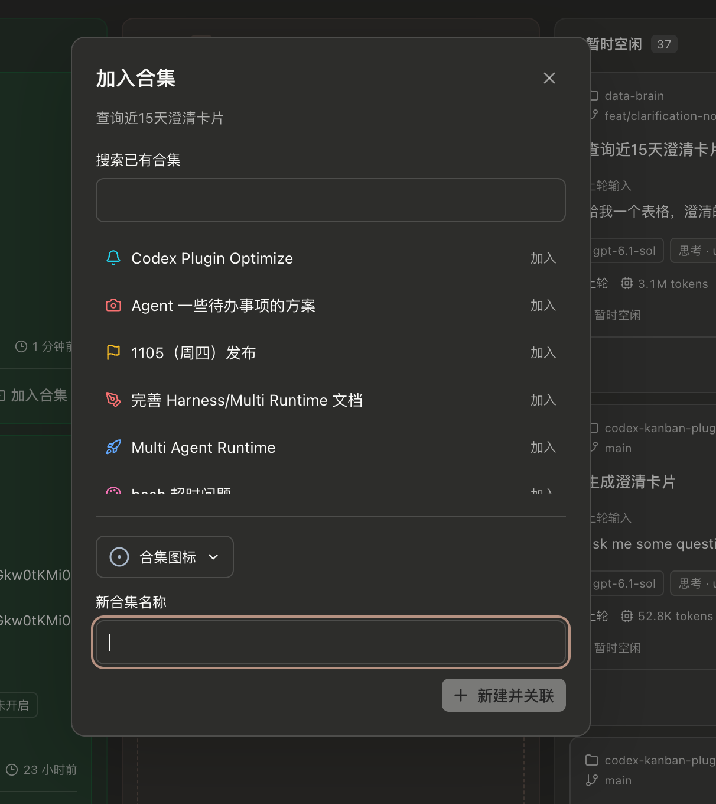
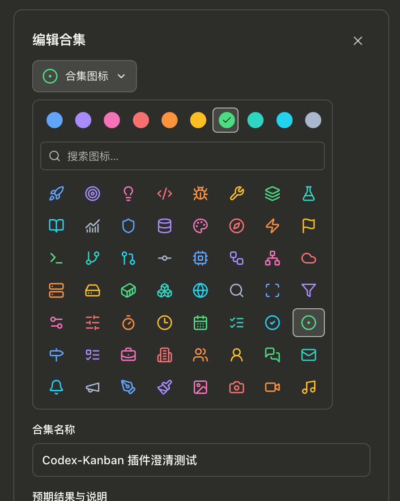

# Codex 重度患者福音！原生插件看板管理并发对话，组织对话合集

## 场景一

插件设计之初是为我自己的需求服务，应该很多人和我一样是 Codex 重度用户，而且会同时开很多个会话，经常是这个会话在出方案、另一个会话在 worktree 写代码、其他还开了一堆的会话在排查线上问题，同时要并行处理很多事情。

当然并行处理并不是阻塞点，毕竟是 AI 处理，阻塞点在于每一个对话结束后都要我们一个一个去 check 才行，这就导致经常会忘记 check，或者不想现在就 check，那随着处理的东西越来越多，之前没有立即 check 的对话，很可能会被漏掉，几十几百个会话里面，漏看一两个是常有的事情，我经常是隔了几天发现这个问题还没被处理，然后来 Codex 根据关键字搜对话，这个时候我又得花时间重新回想一遍这个问题的背景。

甚至有时候会出现你隔了很久来 check 的时候，发现 Codex 竟然需要你输入补充信息，这就更难受了。。。

## 场景二

上面我们重点聊的是并行处理的问题，我经常还会遇到的一个场景是，开多个对话分模块来处理同一个需求，然后这个模块的所有内容我都会在同一个对话里进行，这样做的目的是啥呢，就是保证不同的模块的上下文都是连贯的，一个对话专注处理一个模块，拥有我关于这个模块的所有输入。如果需求开发的时间跨度比较长，就经常会忘记某个模块。如果没有这个插件的话，我目前的解法是统一重命名 + 置顶。

再举个例子，就是我们日常工作中还存在很多调研性的需求，这类工作不一定要及时处理，只是先调研，可能到后面某一天的时候来会拿出来，到时候要找的话，要么是关键字搜索，要么就是把这些对话先置顶。这类需求一多，管理起来就越来越麻烦

## 场景三

我目前的开发流程基本都是写让 Codex 写方案文档/设计稿 -> Goal 模式实现 -> 出验收文档 -> 推送 MR，对我来说要 check 的就 3 个东西：

1. 方案文档
2. 验收文档
3. MR 链接

所以需要不管我在这个对话中聊了多少轮，这三个东西我都能快速的找到，但现在做不到，我经常需要翻上下文来找


## 插件介绍

以上，便是这个插件要解决的问题。

**Codex-Kanban-Plugin**：A Kanban board for Codex power users to manage concurrent chats, tasks, and usage history. 专为 Codex 重度使用者设计，看板模式管理并发对话，组织对话合集

GitHub 地址：[jingchengyin/codex-kanban-plugin](https://github.com/jingchengyin/codex-kanban-plugin)

### 看板




看板按状态分列：

- 需要你处理
- 正在运行
- 未读（对话已完成但还未读）
- 空闲（对话已完成且已经完成）
- 执行异常（比如模型失败，排队超时等等）

看板上展示的信息包括：

- 所属文件夹
- 使用的分支/worktree
- 模型和思考强度
- 计划模式
- 目标模式
- 最近一次的用户输入
- 最近一次 Codex 处理所花费的 token 和时间
- 自动解析出来的成果（目前包括 MR 链接 + 计划文档 + 飞书文档）
- 所属合集

支持自定义配置成果解析 URL：



如果存在需要用户输入的会话，看板卡片会直接展示待确认卡片，可直接在插件内操作，无需跳转会话

### 合集

对应上述场景二，合集支持把多条对话关联起来，统一管理说明、进度、成果和验收清单。



事项有四个状态：待开始、进行中、待验收、已验收，状态由你手动更新。

看板页面也可以快速加入合集：




合集 icon 和颜色支持自定义：




### 关于安全性

插件只读访问本机 Codex 对话数据，所有数据均保存在 `CODEX_HOME/kanban/workspace.sqlite`。没设置 `CODEX_HOME` 时，默认位置是 `~/.codex/kanban/workspace.sqlite`。

### 快速安装

目前只支持 MacOS，Windows 暂未适配，欢迎 PR 👏

把下面这段话发给 Codex，让它帮你安装：

```
请帮我安装 Codex-Kanban-Plugin：https://github.com/jingchengyin/codex-kanban-plugin
从 main 分支添加插件市场，安装 codex-kanban-plugin@codex-kanban-plugin，并检查安装结果。
```
